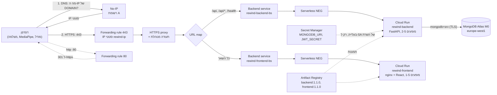

# מדריך הענן של Rewind (מטלה 4)

המדריך הזה מסביר איך Rewind רץ ב-Google Cloud: מה כל רכיב עושה, למה בחרנו בו, איך בקשה עוברת במערכת, ואיך מתחזקים ומכבים. הוא כתוב למי שעוד לא עבדה עם ענן, כדי שתוכלי להסביר כל חלק בהגנה. ההחלטות עצמן, עם האפשרויות שנשקלו, נמצאות ב-[DECISIONS.md](DECISIONS.md) (D-052 עד D-063).

---

## 1. התמונה הגדולה



**במשפט אחד:** הדפדפן מגיע ב-HTTPS ל-IP אחד של Load Balancer גלובלי. ה-LB שולח את `/api` ואת `/health` לשירות השרת ב-Cloud Run, וכל השאר לשירות הלקוח. השרת מדבר עם MongoDB Atlas, והסודות שלו מגיעים מ-Secret Manager.

**מה לא השתנה ממטלה 3:** אותן שתי תמונות (אותו Dockerfile ואותו קוד, tag `1.1.0`). המודל עדיין רץ בדפדפן, והווידאו עדיין לא עוזב את המחשב. מה שהשתנה הוא רק איפה הקונטיינרים רצים ואיך מגיעים אליהם.

---

## 2. מסע של בקשה: מהקלדת הכתובת ועד המסד

1. **הקלדה:** המשתמשת מקלידה `rewind-xxx.ddns.net` בדפדפן.
2. **DNS:** הדפדפן שואל "מה ה-IP של השם הזה?". No-IP עונה מרשומת ה-A: ה-IP הסטטי של ה-LB (`rewind-ip`).
3. **http או https?** אם היא הקלידה `http://`, הבקשה מגיעה ל-forwarding rule על פורט 80. ה-URL map שלו (`rewind-http-redirect`) עונה ב-**301** לאותה כתובת עם `https://`, והדפדפן חוזר מיד ב-HTTPS.
4. **TLS:** על פורט 443 ה-HTTPS proxy מציג את **התעודה המנוהלת** של Google לדומיין. הדפדפן בודק שהיא חתומה ושהשם תואם, ונוצר חיבור מוצפן. מכאן הדף הוא "secure context", ולכן `getUserMedia` (המצלמה) מותר.
5. **URL map:** ה-proxy מסתכל על הנתיב:
   - `/history`, `/`, `/assets/...` ← `rewind-frontend-bs` ← Serverless NEG ← Cloud Run `rewind-frontend` (nginx), שמחזיר את `index.html` ואת קבצי ה-JS, ה-wasm והמודל.
   - `/api/auth/login` ← `rewind-backend-bs` ← Cloud Run `rewind-backend` (FastAPI).
6. **Cloud Run:** אם יש מופע פנוי, הוא מקבל את הבקשה. לשרת יש תמיד לפחות 2 מופעים חמים, וה-LB מחלק ביניהם.
7. **השרת:** בודק את ה-JWT. הסוד `JWT_SECRET` זהה בכל המופעים, כי כולם קוראים אותו מאותו סוד ב-Secret Manager. אחר כך הוא שולח שאילתה ל-MongoDB Atlas ב-TLS, עם ה-URI מ-Secret Manager.
8. **חזרה:** התשובה חוזרת באותה דרך: Cloud Run ← LB ← הדפדפן, מוצפנת.

**מדידה אחת בענן:** בדיוק כמו במטלה 3. המצלמה, MediaPipe ו-v4_7 רצים בדפדפן, ורק `POST /api/sessions/{id}/readings` עם מספרים עובר דרך ה-LB לשרת.

---

## 3. מילון מושגים

| מושג | מה זה | אצלנו |
|---|---|---|
| **Cloud Run** | שירות של Google שמריץ קונטיינרים בלי שנצטרך לנהל שרתים. נותנים לו תמונה, והוא דואג למכונות, לעדכונים ולגדילה | שני שירותים: `rewind-backend` ו-`rewind-frontend` |
| **Container instance (מופע)** | עותק אחד של הקונטיינר שרץ. Cloud Run מוסיף ומוריד מופעים לפי העומס | שרת: 2 עד 5. לקוח: 1 עד 5 |
| **Cold start** | הזמן שלוקח להרים מופע חדש מאפס (הורדת תמונה, עלייה). הבקשה הראשונה מחכה | לא קורה בבדיקה, כי יש min-instances |
| **min-instances** | כמה מופעים תמיד דולקים, גם בלי תעבורה | 2 לשרת (כדי שה-LB באמת יאזן), 1 ללקוח |
| **Load Balancer (LB)** | הרכיב שמקבל את כל התעבורה ב-IP אחד ומחלק אותה בין השרתים | Global External Application LB (`EXTERNAL_MANAGED`) |
| **Serverless NEG** | Network Endpoint Group שמצביע על שירות Cloud Run (ולא על מכונות). כך ה-LB יודע לאן לשלוח | `rewind-backend-neg`, `rewind-frontend-neg` |
| **Backend service** | הגדרה ב-LB של "קבוצת יעד" אחת, עם ה-NEG שלה | `rewind-backend-bs`, `rewind-frontend-bs` |
| **URL map** | טבלת הניתוב של ה-LB: לפי host ונתיב, לאיזה backend service לשלוח | [deploy/urlmap.yaml](../deploy/urlmap.yaml) |
| **Path rule** | כלל אחד ב-URL map: "הנתיבים האלה ← השירות הזה" | `/api`, `/api/*`, `/health` ← שרת |
| **Forwarding rule** | הכלל שמחבר IP ופורט ל-proxy. זה מה שבאמת "מאזין" באינטרנט | 443 ← HTTPS proxy, 80 ← HTTP proxy (redirect) |
| **Static IP** | כתובת IP ששמורה לנו ולא משתנה. בלעדיה רשומת ה-DNS הייתה נשברת | `rewind-ip` (גלובלי) |
| **DNS** | "ספר הטלפונים" של האינטרנט: מתרגם שם לכתובת IP | No-IP |
| **A record** | רשומת DNS שאומרת "השם הזה = ה-IP הזה (IPv4)" | **אחת בלבד**, ל-IP של ה-LB |
| **HTTPS / TLS** | הצפנה של החיבור ואימות שהשרת הוא באמת מי שהוא טוען | כל התעבורה. http מפנה ל-https |
| **Managed certificate** | תעודת TLS ש-Google מנפיקה ומחדשת לבד. היא צריכה שה-DNS כבר יצביע על ה-LB | `rewind-cert` |
| **Secret Manager** | כספת לסודות. השירות מקבל את הסוד כמשתנה סביבה בעלייה, והוא לא נמצא בקוד או בתמונה | `MONGODB_URI`, `JWT_SECRET` |
| **Service Account (SA)** | "משתמש" של תוכנה ולא של אדם. כל שירות רץ בשם SA, וההרשאות ניתנות לו | `rewind-backend`, `rewind-frontend` |
| **IAM role** | אוסף הרשאות שנותנים ל-SA על משאב | `roles/secretmanager.secretAccessor` |
| **Least privilege** | לתת רק את ההרשאה המינימלית שצריך | ה-SA של השרת קורא רק את 2 הסודות שלו. ללקוח אין כלום |
| **Artifact Registry** | מאגר פרטי של תמונות Docker ב-Google Cloud | `europe-west1-docker.pkg.dev/<project>/rewind` |
| **Ingress** | מי מורשה לשלוח בקשות לשירות | `internal-and-cloud-load-balancing`: רק ה-LB. הכתובות הישירות `*.run.app` חסומות |
| **Stateless** | השרת לא זוכר כלום בזיכרון בין בקשות. כל ה-state נמצא במסד | חובה כשיש 2 מופעים (ראו סעיף 5) |
| **Atlas** | MongoDB מנוהל של חברת MongoDB. M0 = cluster חינמי | cluster `rewind` ב-GCP, בלגיה |
| **Access list** | רשימת כתובות IP שמותר להן להתחבר ל-Atlas | `0.0.0.0/0` (ראו D-062 למה, ומה מפצה) |
| **HSTS** | כותרת שאומרת לדפדפן "לאתר הזה תמיד רק HTTPS" לשנה | נשלחת רק כשהבקשה הגיעה ב-HTTPS |

---

## 4. למה HTTPS הכרחי למצלמה

הדפדפן מאפשר `navigator.mediaDevices.getUserMedia` (מצלמה ומיקרופון) רק ב-**secure context**: דף שנטען ב-HTTPS, או מ-`localhost`. זו הסיבה שבמטלה 3 הכול עבד ב-`http://localhost:3000`. אבל `http://rewind-xxx.ddns.net` הוא לא localhost, ושם `navigator.mediaDevices` פשוט לא קיים. לכן בענן HTTPS הוא לא רק "אבטחה טובה": בלעדיו האתר לא יכול למדוד ריכוז בכלל. בגלל זה יש:
- תעודה מנוהלת (`rewind-cert`);
- הפניה 301 מ-http ל-https, למי שמקלידה בלי https;
- HSTS, כדי שהדפדפן לא ינסה http בפעם הבאה.

---

## 5. למה stateless, ולמה JWT_SECRET משותף

**הבעיה מהשיעור על LB:** ה-LB שולח כל בקשה למופע אחר. אם השרת שומר משהו בזיכרון (סשן, מונה ניסיונות, רשימת טוקנים), הבקשה הבאה עלולה להגיע למופע שלא יודע על זה.

**אצלנו:**
- **הכול במונגו:** משתמשים, תוכן, סשנים, מדידות, **ניסיונות התחברות** (`login_attempts` עם TTL) ו**טוקנים מבוטלים** (`revoked_tokens` עם TTL). לכן לא משנה לאיזה מופע הבקשה מגיעה.
- **JWT_SECRET:** טוקן נחתם בסוד. אם לכל מופע היה סוד אחר, טוקן ממופע A היה נדחה במופע B, וההתחברות הייתה "קופצת" באקראי. במטלה 3, כשאין סוד, השרת מייצר אחד אקראי. **בענן (`ENV=production`) השרת פשוט מסרב לעלות בלי `JWT_SECRET`** (D-053), וכל המופעים מקבלים את אותו סוד מ-Secret Manager.
- **הוכחה:** `e2e/tests/cloud.spec.js` שולח 20 בקשות `GET /api/users/me` ברצף עם אותו טוקן, וכולן צריכות לחזור 200, למרות שהן מתחלקות בין המופעים.

---

## 6. איך עובדים עם זה: הסקריפטים

כל הסקריפטים ב-[deploy/](../deploy/) כתובים ב-PowerShell. מריצים אותם מתיקיית הפרויקט:
```powershell
powershell -ExecutionPolicy Bypass -File deploy\<script>.ps1
```

| סקריפט | מה הוא עושה | מתי |
|---|---|---|
| `install-tools.ps1` | מוריד gcloud, Atlas CLI ו-gh בגרסה portable (בלי הרשאות מנהל) | פעם אחת |
| `deploy.ps1` | הכול: APIs, Artifact Registry, SA, סודות, תמונות, Cloud Run, LB, תעודה, budget, uptime. **אידמפוטנטי**: אפשר להריץ שוב בבטחה. `-DryRun` רק מדפיס את הפקודות | בהתחלה, ובכל פעם שמשהו חסר |
| `status.ps1 [-Wait]` | שירותים, IP, DNS, תעודה ו-/health. עם `-Wait` בודק כל 2 דקות עד 60 דקות | בזמן ההמתנה לתעודה |
| `verify.ps1 [-ViaIp]` | כל טבלת הבדיקה של מטלה 4, כולל E2E מול הדומיין. כותב ל-`docs/A4_VERIFY_RESULTS.md` | כשהתעודה ACTIVE |
| `redeploy.ps1 [-Tag x]` | רק גרסה חדשה: build, push ו-update לשני השירותים | אחרי שינוי קוד |
| `make-submission.ps1` | יוצר ובודק את `submission/rewind.json` | לפני ההגשה |
| `teardown.ps1 -Yes` | מוחק את מה שנוצר (LB, Cloud Run, תמונות). **לא לפני הבדיקה** | אחרי שהציון התקבל |

**לעדכן גרסה:** משנים קוד ← בודקים מקומית (`docker compose -f docker-compose.dev.yml up --build`) ← `.\deploy\redeploy.ps1 -Tag 1.1.1` ← מעדכנים את `$IMAGE_TAG` ב-`config.ps1` ← `.\deploy\status.ps1`.

---

## 7. כשמשהו לא עובד

| מה רואים | הסיבה הסבירה | מה עושים |
|---|---|---|
| תעודה `PROVISIONING` הרבה זמן | רגיל עד 60 דקות **אחרי** שה-DNS מצביע נכון | `.\deploy\status.ps1 -Wait` ולחכות |
| תעודה `FAILED_NOT_VISIBLE` | רשומת ה-A ב-No-IP לא מצביעה על ה-IP של ה-LB (או שיש עוד רשומה) | לתקן ב-No-IP ל-A **אחת** = ה-IP מ-`deploy\last-ip.txt`. Google מנסה שוב לבד |
| `Resolve-DnsName` מחזיר IP אחר | No-IP לא עודכן, או cache | לעדכן ב-No-IP ולחכות כמה דקות |
| `https://DOMAIN` לא נפתח, אבל `-ViaIp` עובד | התעודה עוד לא ACTIVE | לחכות. `verify.ps1 -ViaIp` רק לאבחון |
| 404 מה-LB על `/api/...` | URL map לא נכון | `gcloud compute url-maps describe rewind-urlmap --global`, ואז `deploy.ps1` שוב |
| `/health` מחזיר 503 | השרת לא מצליח לדבר עם Atlas | לבדוק את ה-URI ב-Secret Manager (גרסה אחרונה), את ה-access list ב-Atlas (`0.0.0.0/0`), ואת הסיסמה |
| השרת לא עולה, ובלוג `FATAL: JWT_SECRET is required` | הסוד לא מחובר | `deploy.ps1` שוב (`--set-secrets`) |
| התחברות "קופצת" (401 אקראי) | שני מופעים עם סוד שונה | לא אמור לקרות (D-053). לבדוק שאין `JWT_SECRET` כמשתנה רגיל |
| המצלמה לא נדלקת בענן | האתר נפתח ב-http, או שהמשתמשת חסמה | לפתוח ב-`https://` |
| `*.run.app` נפתח מבחוץ | ingress לא מוגבל | `gcloud run services update <svc> --ingress internal-and-cloud-load-balancing --region europe-west1` |
| `deploy.ps1` נכשל ב-`allUsers` | מדיניות ארגון | הסקריפט עובר לבד ל-`--no-invoker-iam-check` (D-060) |
| האתר נפל אחרי 30 יום | ה-hostname ב-No-IP לא אושר | להיכנס ל-No-IP ולאשר (Confirm). לשים תזכורת ביומן |

לוגים: `gcloud run services logs read rewind-backend --region europe-west1 --limit 50`.

---

## 8. עלויות (הערכה)

מחירון 2026, europe-west1. לבדוק במחשבון: https://cloud.google.com/products/calculator

| רכיב | הנחה | הערכה לחודש |
|---|---|---|
| Forwarding rules (443 + 80) | 0.025$ לשעה לחמשת הכללים הראשונים | כ-18$ |
| Cloud Run backend, min 2 | מופע idle של 1 vCPU / 512Mi | כ-15–20$ |
| Cloud Run frontend, min 1 | מופע idle של 1 vCPU / 256Mi | כ-7–9$ |
| תעבורה ובקשות | מעט מאוד | פחות מ-1$ |
| Artifact Registry | 2 תמונות, כ-0.5GB | כ-0–0.1$ |
| IP סטטי | בשימוש של forwarding rule | כלול |
| תעודה מנוהלת, Secret Manager, Uptime check | בתוך המכסה החינמית | 0$ |
| MongoDB Atlas M0 | חינמי | 0$ |
| **סה"כ** | | **כ-40–50$ לחודש** מתוך קרדיט של 300$ |

**Budget** של 50$ עם התראות ב-50%, ב-90% וב-100% (`rewind-budget`). **לא לשדרג את חשבון ה-Free Trial.** אחרי שהציון התקבל: `.\deploy\teardown.ps1 -Yes`. רוב העלות היא ה-forwarding rules וה-min instances, ושניהם נמחקים.

---

## 9. שאלות הגנה צפויות ותשובות

1. **למה Cloud Run ולא VM?** Cloud Run מריץ את אותם קונטיינרים בלי שננהל מערכת הפעלה, עדכונים, דיסק או instance group. הוא גדל ומקטין לבד, ותקלה בשירות אחד לא מפילה את השני. VM היה דורש firewall, עדכונים ידניים ו-instance group כדי לעבוד מאחורי LB.
2. **למה Atlas ולא Cloud SQL?** הקוד כבר כתוב ל-MongoDB, אז לא שינינו שורה. Atlas M0 חינמי ומנוהל (גיבוי, עדכונים, TLS). Cloud SQL עולה כסף כל שעה ומחייב מעבר ל-SQL.
3. **כמה מופעים ולמה?** לשרת min 2 ו-max 5: שניים כדי שה-LB באמת יאזן, ושלא יהיה cold start בבדיקה. ללקוח min 1, כי הוא רק מגיש קבצים סטטיים. max 5 מגביל את העלות.
4. **מה קורה אם מופע אחד נופל?** Cloud Run מפסיק לשלוח אליו ומרים מופע חדש. בינתיים המופע השני ממשיך לענות. כי השרת stateless, אף משתמשת לא "מתנתקת".
5. **איך שמרתם על סודות?** `MONGODB_URI` ו-`JWT_SECRET` נמצאים רק ב-Secret Manager, ומחוברים לשירות עם `--set-secrets`. רק ה-SA של השרת יכול לקרוא אותם, ורק אותם. הם לא בקוד, לא ב-Git, לא בתמונה ולא בלוג, וסריקה לפני כל commit מוודאת את זה.
6. **למה ה-LB מנתב לפי נתיב?** כדי שהאתר וה-API יהיו באותו דומיין ובאותו origin. אז אין CORS, והלקוח פונה ל-`/api` יחסי, בדיוק כמו ב-compose.
7. **למה אין health check ב-LB?** Serverless NEG לא תומך ב-health check, כי Cloud Run עצמו מנהל את בריאות המופעים. לכן גם לא צריך firewall rule לבדיקות. את הזמינות מבחוץ בודק ה-Uptime check.
8. **מה זה Serverless NEG?** קבוצת יעד של ה-LB שמצביעה על שירות Cloud Run ולא על כתובות IP של מכונות. ככה ה-LB יכול לשלוח לשירות שהמופעים שלו מתחלפים כל הזמן.
9. **למה `0.0.0.0/0` ב-Atlas, ומה מפצה על זה?** ל-Cloud Run אין IP יוצא קבוע, ו-IP קבוע (VPC connector + Cloud NAT) עולה כסף. מפצים במשתמש DB עם `readWrite` רק על `rewind`, בסיסמה אקראית של 32 תווים שקיימת רק ב-Secret Manager, וב-TLS חובה.
10. **מה קורה אם ה-hostname ב-No-IP לא אושר?** No-IP מבטל hostname חינמי שלא אושר כל 30 יום. אז ה-DNS לא מחזיר את ה-IP, האתר לא נפתח, והתעודה לא תתחדש. לכן יש תזכורת ביומן.
11. **מה קורה ב-cold start?** מופע חדש עולה: Cloud Run מוריד את התמונה ומפעיל אותה, וזה לוקח כמה שניות, והבקשה הראשונה מחכה. בגלל min-instances זה לא קורה ברגיל, רק כשהעומס גדל מעבר למופעים הקיימים.
12. **למה ingress מוגבל?** כדי שכל התעבורה תעבור דרך ה-LB: HTTPS, התעודה, ה-redirect וה-HSTS. הכתובות `*.run.app` הישירות מחזירות 404 מבחוץ, ו-`verify.ps1` בודק את זה.
13. **למה JWT_SECRET חייב להיות משותף?** כי טוקן שנחתם במופע אחד נבדק במופע אחר. סוד שונה = 401 אקראי. לכן ב-production השרת לא עולה בלי הסוד.
14. **מה זה stateless ואיך בדקתם?** אין state בזיכרון: ניסיונות התחברות, טוקנים מבוטלים וכל השאר במונגו. 20 בקשות עם אותו טוקן, שמתחלקות בין המופעים, חוזרות כולן 200.
15. **למה המצלמה דורשת HTTPS?** `getUserMedia` מותר רק ב-secure context. בלי HTTPS אין מדידה בכלל.
16. **מה קורה כשמקלידים `http://`?** ה-forwarding rule על 80 מחזיר 301 ל-`https://` עם אותו נתיב. הדפדפן עובר לבד.
17. **איך התעודה נוצרת ומתחדשת?** Google מנפיקה אותה אחרי שהיא רואה שה-DNS של הדומיין מצביע על ה-LB, ומחדשת אותה לבד לפני שהיא פגה. אצלנו אין שום קובץ תעודה.
18. **איך מעדכנים גרסה?** `redeploy.ps1 -Tag 1.1.1`: build ל-amd64, push ל-Artifact Registry, ו-`gcloud run services update --image` לשני השירותים. Cloud Run מעביר את התעבורה לגרסה החדשה רק כשהיא עלתה.
19. **למה Artifact Registry ולא Docker Hub?** פרטי, באותו region (משיכה מהירה כשמופע עולה), ובלי rate limits. Docker Hub נשאר למטלה 3.
20. **למה אותה תמונה בשני המקומות?** כדי שמה שבדקנו מקומית זה בדיוק מה שרץ בענן. משתני סביבה קובעים את הפורט (`PORT`) והאם nginx עושה proxy (`BACKEND_URL`).
21. **מה היה נשבר בלי השינוי ב-nginx?** ב-compose nginx עושה proxy ל-`http://backend:8000`. בענן אין host בשם `backend`, ולכן ה-proxy נוצר רק כש-`BACKEND_URL` לא ריק (D-052).
22. **איך הגבלת הניסיונות עובדת מאחורי LB?** uvicorn עם `--proxy-headers` לוקח את ה-IP של הלקוח מ-`X-Forwarded-For`. כי הכותרת הזו ניתנת לזיוף, הוספנו גם מגבלה של 20 כישלונות לאימייל מכל ה-IP יחד (D-054).
23. **כמה זה עולה?** בערך 40–50$ לחודש, בעיקר ה-forwarding rules ו-min instances. יש Budget של 50$ עם התראות, ו-teardown אחרי הבדיקה.
24. **למה Uptime check?** כדי לדעת מיד אם האתר נפל בחלון הבדיקה. הוא בודק `https://DOMAIN/health` כל 5 דקות, כולל שהגוף מכיל `ok`, כלומר שהשרת **וגם** המסד עובדים.
25. **מה ההבדל בין משתנה סביבה לסוד?** `ENV`, `DB_NAME` ו-`ALLOWED_ORIGINS` הם הגדרות שלא מזיק שיראו אותן, ולכן הם משתנים רגילים. URI עם סיסמה ומפתח חתימה הם סודות: Secret Manager, הרשאה פר-SA, היסטוריית גרסאות.
26. **מה עושים אם סוד דלף?** מוסיפים גרסה חדשה ב-Secret Manager (`gcloud secrets versions add`), מחליפים סיסמה ב-Atlas, ומריצים `redeploy`. אם זה `JWT_SECRET`, כל המשתמשים יתנתקו, וזה בדיוק מה שרוצים.

---

## 10. איך מכבים אחרי הבדיקה

```powershell
.\deploy\teardown.ps1 -Yes                  # LB, Cloud Run, תמונות, uptime check
.\deploy\teardown.ps1 -Yes -IncludeSecrets  # וגם הסודות וה-Service Accounts
```
מה נשאר: ה-Budget (חינם) וה-cluster ב-Atlas (חינם; אפשר למחוק ב-UI של Atlas). **להשאיר הכול דולק** עלול לעלות כ-40–50$ לחודש מהקרדיט.
