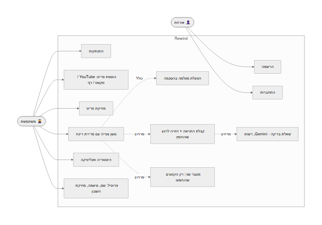
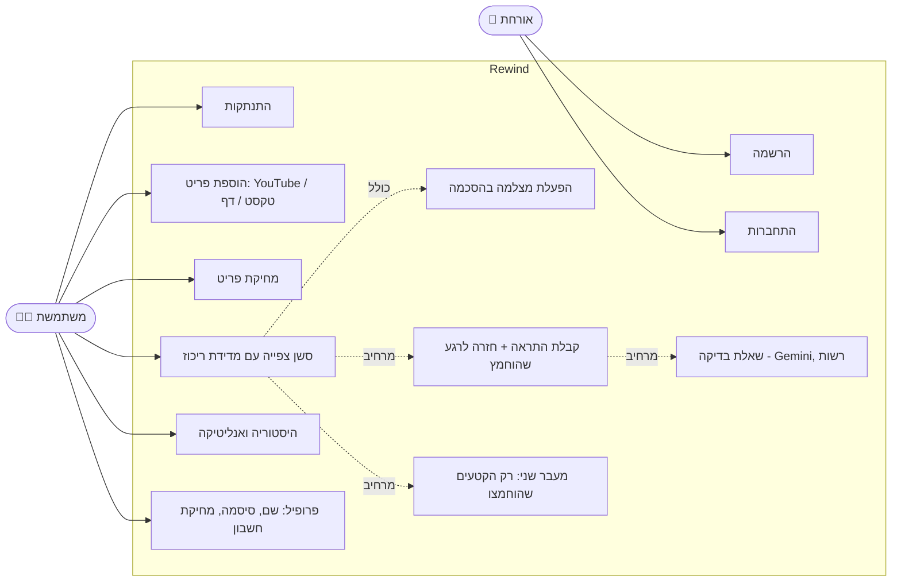
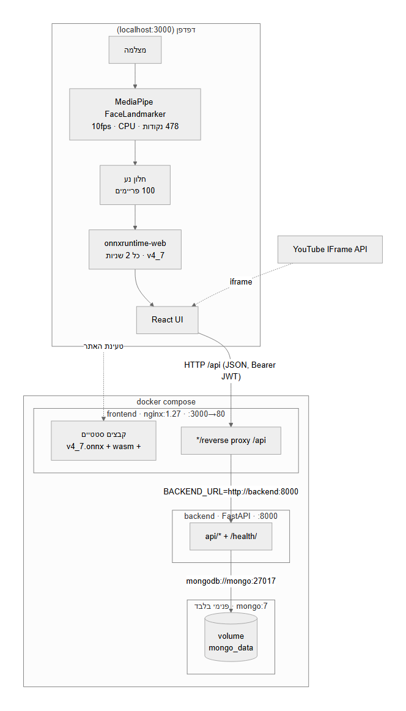
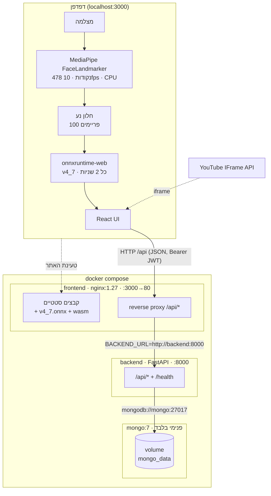
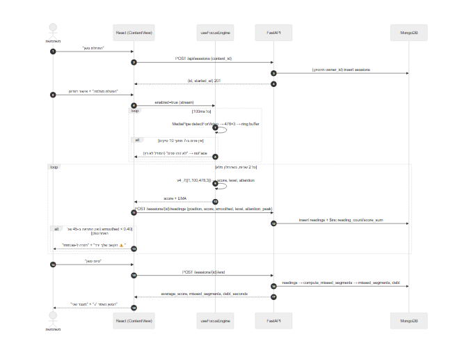
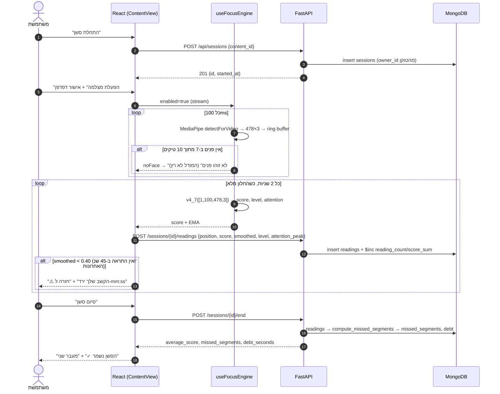
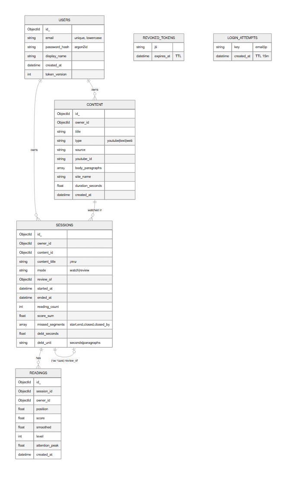
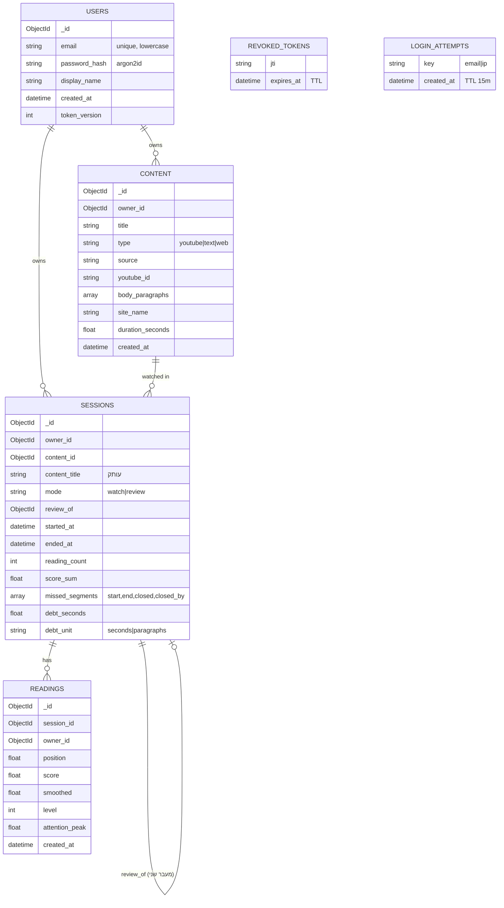
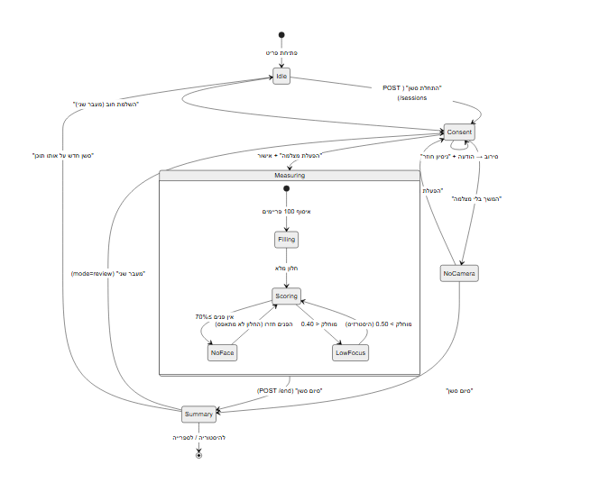
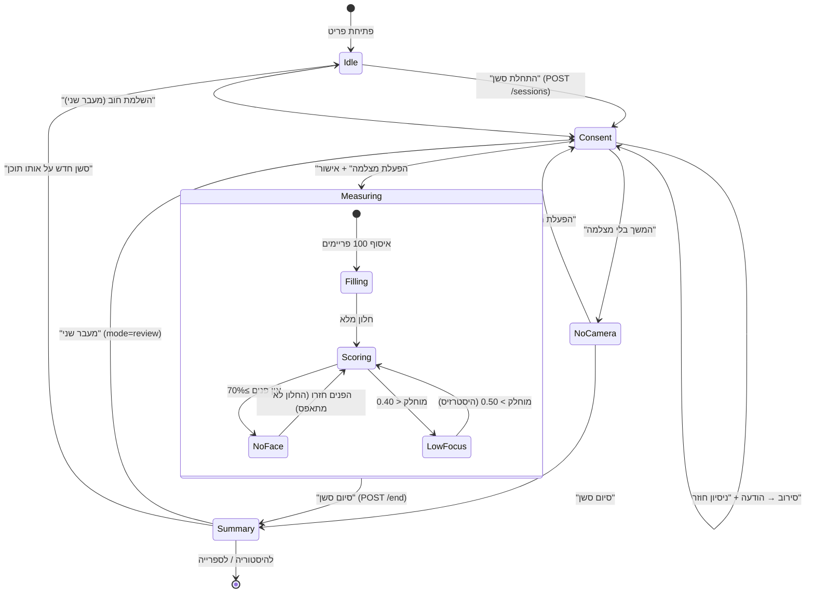

# דיאגרמות Rewind

כל הדיאגרמות כתובות ב-Mermaid (GitHub ו-VS Code מציגים אותן ישירות). קובצי PNG נוצרו מהן עם `e2e/render_diagrams.mjs`.

## 1. Use Case

## 2. ארכיטקטורה: 3 קונטיינרים

## 3. Sequence: סשן צפייה ומדידה אחת

## 4. ERD: אוספי MongoDB

## 5. מכונת המצבים של פאנל הריכוז

